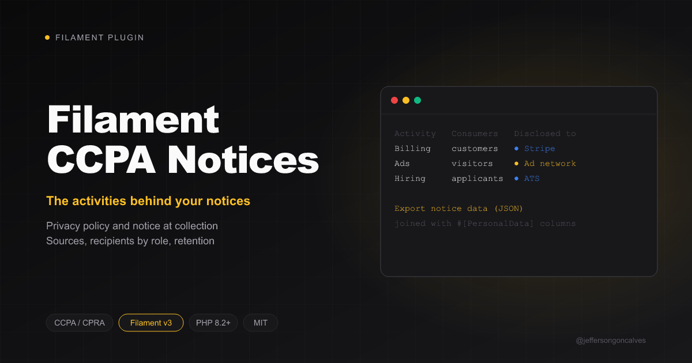

<div class="filament-hidden">



</div>

# Filament CCPA Notices

[](https://packagist.org/packages/jeffersongoncalves/filament-ccpa-notices)
[](https://github.com/jeffersongoncalves/filament-ccpa-notices/actions?query=workflow%3Atests+branch%3A2.x)
[](https://github.com/jeffersongoncalves/filament-ccpa-notices/actions?query=workflow%3A"Fix+PHP+code+styling"+branch%3A2.x)
[](https://packagist.org/packages/jeffersongoncalves/filament-ccpa-notices)
[](LICENSE.md)

Manage the processing activities behind the privacy policy and notice at collection of [laravel-ccpa-notices](https://github.com/jeffersongoncalves/laravel-ccpa-notices) (Cal. Civ. Code §§1798.100(b) and 1798.130(a)(5)) from your Filament panel, and export them joined with the personal information you declared in your models.

## Features

- Processing activities: business or commercial purpose, consumers, categories of personal information, sources and retention.
- Link activities to the models of `ccpa.models`: the personal information declared on them, with its CCPA category and sold/shared flags, joins the activity.
- Recipients by role: service provider, contractor or third party.
- **Export notice data (JSON):** the business, the categories collected, sensitive, sold and shared, and every activity, in one file.
- 19 languages.

## Compatibility

| Plugin Version                                                              | Filament |
|-----------------------------------------------------------------------------|----------|
| [1.x](https://github.com/jeffersongoncalves/filament-ccpa-notices/tree/1.x) | 3.x      |
| [2.x](https://github.com/jeffersongoncalves/filament-ccpa-notices/tree/2.x) | 4.x      |
| [3.x](https://github.com/jeffersongoncalves/filament-ccpa-notices/tree/3.x) | 5.x      |

## Installation

You can install the package via composer:

```bash
composer require jeffersongoncalves/filament-ccpa-notices:"^2.0"
php artisan vendor:publish --tag="ccpa-notices-migrations"
php artisan migrate
```

The business is configured in laravel-ccpa-notices' `ccpa-notices` config (or the `CCPA_BUSINESS_NAME`, `CCPA_BUSINESS_CONTACT` and `CCPA_TOLL_FREE_NUMBER` env variables).

## Usage

```php
use JeffersonGoncalves\Filament\CcpaNotices\CcpaNoticesPlugin;

public function panel(Panel $panel): Panel
{
    return $panel
        ->plugins([
            CcpaNoticesPlugin::make()
                ->navigationGroup('CCPA')             // default: no group
                ->navigationSort(5)
                ->navigationIcon('heroicon-o-clipboard-document-list')
                ->slug('processing-activities'),
        ]);
}
```

All fluent methods are optional.

> The resource has no authorization of its own: register it only on panels whose users maintain the notices, or add a policy for `JeffersonGoncalves\CcpaNotices\Models\ProcessingActivity`.

## Testing

```bash
composer test
```

## Changelog

Please see [CHANGELOG](CHANGELOG.md) for more information on what has changed recently.

## Contributing

Please see [CONTRIBUTING](.github/CONTRIBUTING.md) for details.

## Security Vulnerabilities

Please review [our security policy](../../security/policy) on how to report security vulnerabilities.

## Credits

- [Jefferson Gonçalves](https://github.com/jeffersongoncalves)
- [All Contributors](../../contributors)

## License

The MIT License (MIT). Please see [License File](LICENSE.md) for more information.
